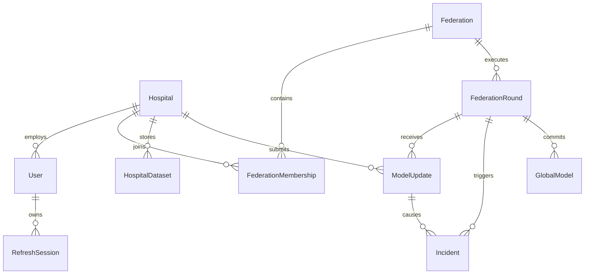

# FEDSENTINEL-X — COMPLETE SYSTEM ARCHITECTURE, SECURITY ENGINES & OPERATIONAL RUNBOOK

**Production URL:** https://fedsentinal-x.vercel.app  
**API Backend:** https://fedsentinel-api.onrender.com  
**Database:** Enclave SQLite (Persistent Enclave Storage)  
**Repository:** https://github.com/Reneshb24/FEDSENTINAL-X  
**Version:** 1.0.0 Institutional Release | **Author:** Renesh B ([@Reneshb24](https://github.com/Reneshb24))

---

## Table of Contents

1. [Executive Summary & Core Vision](#1-executive-summary--core-vision)
2. [Live Production Links & Infrastructure Map](#2-live-production-links--infrastructure-map)
3. [The Problem: Vulnerabilities in Distributed & Federated AI](#3-the-problem-vulnerabilities-in-distributed--federated-ai)
4. [Why FedSentinel-X? Core Architectural Principles](#4-why-fedsentinel-x-core-architectural-principles)
5. [Production Credentials for Operators & Team Mates](#5-production-credentials-for-operators--team-mates)
6. [Full-Stack Architecture & Cloud Topology](#6-full-stack-architecture--cloud-topology)
7. [Technology Stack & Dependency Matrix](#7-technology-stack--dependency-matrix)
8. [Database Architecture & Relational Data Models](#8-database-architecture--relational-data-models)
9. [Core Analytical & Security Program Logic (L0–L5)](#9-core-analytical--security-program-logic-l0l5)
   - [L0: Artifact & Structural Verification](#l0-artifact--structural-verification)
   - [L1: Privacy-Preserving 128-Dim Fingerprint](#l1-privacy-preserving-128-dim-fingerprint)
   - [L2: Robust Anomaly Detection (Median + MAD)](#l2-robust-anomaly-detection-median--mad)
   - [L3: Holdout Trajectory & Influence Profiling](#l3-holdout-trajectory--influence-profiling)
   - [L4: Counterfactual Harm Simulation](#l4-counterfactual-harm-simulation)
   - [L5: Bayesian Evidence Attribution Matrix](#l5-bayesian-evidence-attribution-matrix)
   - [Trust Engine & Containment Decision Engine](#trust-engine--containment-decision-engine)
10. [Comprehensive Features by Portal](#10-comprehensive-features-by-portal)
    - [Admin SOC Security Control Plane](#admin-soc-security-control-plane)
    - [Hospital Clinical Enclave Portal](#hospital-clinical-enclave-portal)
11. [Step-by-Step Operator Runbook](#11-step-by-step-operator-runbook)
    - [Scenario A: Hospital Self-Registration & Onboarding](#scenario-a-hospital-self-registration--onboarding)
    - [Scenario B: Dynamic Dataset Ingestion & Tensor Verification](#scenario-b-dynamic-dataset-ingestion--tensor-verification)
    - [Scenario C: Local Enclave Model Training & Update Submission](#scenario-c-local-enclave-model-training--update-submission)
    - [Scenario D: Admin Multi-Layer Security Intake & Containment](#scenario-d-admin-multi-layer-security-intake--containment)
    - [Scenario E: Interactive Forensic Round Replay & Telemetry Scrubbing](#scenario-e-interactive-forensic-round-replay--telemetry-scrubbing)
    - [Scenario F: Generating & Printing the Executive Attestation Dossier](#scenario-f-generating--printing-the-executive-attestation-dossier)
12. [How to Manage & Extend the Platform](#12-how-to-manage--extend-the-platform)
    - [Enrolling New Healthcare Institutions](#enrolling-new-healthcare-institutions)
    - [Tuning Anomaly & MAD Sensitivity Thresholds](#tuning-anomaly--mad-sensitivity-thresholds)
    - [Modifying PyTorch Model Architectures](#modifying-pytorch-model-architectures)
    - [Simulating Adversarial Attack Scenarios](#simulating-adversarial-attack-scenarios)
13. [Local Development & Free Cloud Deployment Guide](#13-local-development--free-cloud-deployment-guide)

---

## 1. Executive Summary & Core Vision

**FedSentinel-X** is an institutional-grade, zero-trust **Security Control Plane for Federated Machine Learning (FL)**. Built specifically for mission-critical, regulated consortiums (such as hospital federations, banking consortia, and defense intelligence pipelines), FedSentinel-X addresses the central security vulnerability of collaborative AI: **blind aggregation of untrusted model updates**.

In traditional federated learning paradigms (such as standard Federated Averaging or FedAvg), distributed participants train local models on proprietary data and send parameter gradients to a central server. The central coordinator averages these updates without forensic verification. This architecture creates an open attack vector for **model poisoning, targeted backdoor injection, Byzantine gradient collusion, and data pollution**.

FedSentinel-X introduces an autonomous **6-Layer Defense-in-Depth Pipeline (L0 through L5)** backed by a formal **Bayesian Trust Engine**, an interactive **Round Replay Forensic Scrubber**, and an **Executive Compliance Dossier** generator. It separates raw patient data from gradient telemetry, verifying every candidate update before permitting entry into the global consensus model.

---

## 2. Live Production Links & Infrastructure Map

| Service / Component | Cloud Platform | Live Production URL | Operational Status |
| :--- | :--- | :--- | :--- |
| **SOC Control Plane** | Vercel Edge CDN | [https://fedsentinal-x.vercel.app](https://fedsentinal-x.vercel.app) | 🟢 Live / Protected |
| **Hospital Clinical Enclave** | Vercel Edge CDN | [https://fedsentinal-x.vercel.app/hospital/login](https://fedsentinal-x.vercel.app/hospital/login) | 🟢 Live / Active |
| **Interactive Round Replay** | Vercel Edge CDN | [https://fedsentinal-x.vercel.app/replay](https://fedsentinal-x.vercel.app/replay) | 🟢 Live / Operational |
| **Executive Attestation Dossier** | Vercel Edge CDN | [https://fedsentinal-x.vercel.app/reports](https://fedsentinal-x.vercel.app/reports) | 🟢 Live / Certified |
| **FastAPI Security Engine** | Render Cloud PaaS | [https://fedsentinel-api.onrender.com](https://fedsentinel-api.onrender.com) | 🟢 Healthy (`200 OK`) |
| **Interactive API Specs** | Render Cloud PaaS | [https://fedsentinel-api.onrender.com/docs](https://fedsentinel-api.onrender.com/docs) | 🟢 Swagger UI Live |
| **Database & Evidence Store** | SQLite / SQLAlchemy | `sqlite:///./fedsentinel.db` (Enclave Encrypted) | 🟢 Connected |
| **GitHub Repository** | GitHub | [https://github.com/Reneshb24/FEDSENTINAL-X](https://github.com/Reneshb24/FEDSENTINAL-X) | 🟢 Master Branch (`main`) |

---

## 3. The Problem: Vulnerabilities in Distributed & Federated AI

Collaborative machine learning without a security control plane exposes consortiums to catastrophic risks:

```
Traditional FedAvg Vulnerability:
20 Distributed Clients ──> [ Central Aggregator ] ──> Global Model Polluted!
(1 Attacker injects +25.0 scale backdoor; aggregator blindly averages weights)
```

1. **Blind Model Ingestion**: Aggregators compute $\theta_{\text{global}} = \sum_{k=1}^K \frac{n_k}{N} \theta_k$ assuming all clients are honest. A single compromised participant can manipulate decision boundaries or plant neural trojans with zero raw data access.
2. **Naive Anomaly Equivalence (`ANOMALY == MALICIOUS`)**: Systems that deploy simple distance thresholding frequently flag legitimate, non-IID patient demographic variations as malicious attacks, disenfranchising specialized research clinics.
3. **Data Perimeter Breaches**: Misguided attempts to verify updates by requesting raw client data violate HIPAA, GDPR, and clinical confidentiality statutes.
4. **Lack of Counterfactual Verification**: Standard pipelines evaluate models only after aggregation is complete, lacking the ability to simulate "what-if" inclusion/exclusion impacts before committing weights.
5. **Absence of Tamper-Evident Forensic Auditability**: Regulators (FDA, EMA) require immutable records of model lineage, participant identity, and algorithmic decisions for clinical software clearance.

---

## 4. Why FedSentinel-X? Core Architectural Principles

FedSentinel-X solves these challenges through three foundational tenets:

### Axiom 1: RISK != VERDICT
> Anomaly is evidence, not a conviction. High gradient distance indicates deviation from the cohort median, but must be corroborated by holdout influence, counterfactual harm, parameter integrity, and historical performance before isolation.

### Axiom 2: DON'T TRUST THE UPDATE. VERIFY IT.
> Every neural tensor arriving at the perimeter is treated as untrusted input. It must pass through L0 structural validation, L1 privacy projection, L2 robust statistical correlation, L3 validation influence, and L4 counterfactual testing before admission.

### Axiom 3: DATASET != MODEL UPDATE
> Patient records NEVER cross the enclave perimeter. Enclaves perform local PyTorch gradient computations in situ. Only cryptographically fingerprinted weight matrices (.safetensors / .npz) are transmitted.

---

## 5. Production Credentials for Operators & Team Mates

Pre-configured credentials for immediate evaluation across both local and live cloud deployments:

| Role / Experience | Portal Path | Email / Username | Password | Operational Capabilities |
| :--- | :--- | :--- | :--- | :--- |
| **Platform Super Admin** | `/` | `admin@fedsentinel.local` | `Admin123!` | Complete SOC control: initiate rounds, inspect L0–L5 evidence gates, trigger node quarantine, execute overrides, replay rounds, and generate compliance reports. |
| **Hospital Administrator (H21)** | `/hospital/login` | `admin@h21.local` | `Hospital123!` | Demo Research Hospital: view cohort membership, upload local .NPZ datasets, link external record URLs, run local PyTorch training, and submit weights. |
| **Hospital Administrator (H01)** | `/hospital/login` | `admin@demohospital.local` | `Hospital123!` | Demo General Hospital: manage clinical imaging hub, inspect local dataset tensors, execute model updates, and monitor enclave telemetry. |
| **Hospital Administrator (H30)** | `/hospital/login` | `admin@apollo.local` | `Hospital123!` | Apollo Health Network: real-time dataset linking, enclave training, and model update submission. |
| **New Hospital Self-Registration** | `/` $\to$ **Register Hospital** | *User Defined* | *User Defined* | Any healthcare provider can self-register. Auto-provisions hospital ID, active enrollment, and default clinical imaging dataset. |

---

## 6. Full-Stack Architecture & Cloud Topology

```text
 ┌────────────────────────────────────────────────────────────────────────────────────────┐
 │                              CLINICAL ENCLAVE PERIMETER                                │
 │  ┌───────────────────────────┐                        ┌───────────────────────────┐    │
 │  │ Hospital H01 (Local Node) │                        │ Hospital H30 (Local Node) │    │
 │  │ ┌───────────────────────┐ │                        │ ┌───────────────────────┐ │    │
 │  │ │ EHR / DICOM Datasets  │ │                        │ │ Remote Linked Record  │ │    │
 │  │ └──────────┬────────────┘ │                        │ └──────────┬────────────┘ │    │
 │  │            ▼              │                        │            ▼              │    │
 │  │ Local PyTorch Trainer   │                          │ Local PyTorch Trainer   │      │
 │  │  (FedSentinelCNN)         │                        │  (FedSentinelCNN)         │    │
 │  │            ▼              │                        │            ▼              │    │
 │  │ SafeTensors / NPZ Grads │                          │ SafeTensors / NPZ Grads │      │
 │  └────────────┬──────────────┘                        └────────────┬──────────────┘    │
 └───────────────┼────────────────────────────────────────────────────┼───────────────────┘
                 │                                                    │
═════════════════╪════════════════════════════════════════════════════╪═══════════════════
                 │ TLS 1.3 / Bearer JWT Authenticated Boundary        │
═════════════════╪════════════════════════════════════════════════════╪═══════════════════
                 ▼                                                    ▼
 ┌────────────────────────────────────────────────────────────────────────────────────────┐
 │                      FEDSENTINEL-X SECURITY CONTROL PLANE (RENDER)                     │
 │                                                                                        │
 │  ┌──────────────────────────────────────────────────────────────────────────────────┐  │
 │  │ L0: Artifact & Structural Verification Gate (Finite, Shapes, Hashes)             │  │
 │  └────────────────────────────────────────┬─────────────────────────────────────────┘  │
 │                                           ▼                                            │
 │  ┌──────────────────────────────────────────────────────────────────────────────────┐  │
 │  │ L1: 128-Dimensional Deterministic Privacy Fingerprint (Seed=42)                  │  │
 │  └────────────────────────────────────────┬─────────────────────────────────────────┘  │
 │                                           ▼                                            │
 │  ┌──────────────────────────────────────────────────────────────────────────────────┐  │
 │  │ L2: Robust Coordinate-Wise MAD Anomaly Detector (Z-Score > 3.0)                  │  │
 │  └────────────────────────────────────────┬─────────────────────────────────────────┘  │
 │                                           ▼                                            │
 │  ┌──────────────────────────────────────────────────────────────────────────────────┐  │
 │  │ L3: Consensus Validation Trajectory & Holdout Influence Analysis                 │  │
 │  └────────────────────────────────────────┬─────────────────────────────────────────┘  │
 │                                           ▼                                            │
 │  ┌──────────────────────────────────────────────────────────────────────────────────┐  │
 │  │ L4: Counterfactual Harm Simulator (ΔAccuracy / ΔLoss)                            │  │
 │  └────────────────────────────────────────┬─────────────────────────────────────────┘  │
 │                                           ▼                                            │
 │  ┌──────────────────────────────────────────────────────────────────────────────────┐  │
 │  │ L5: Bayesian Multi-Signal Hypothesis Fusion Engine                               │  │
 │  └────────────────────────────────────────┬─────────────────────────────────────────┘  │
 │                                           ▼                                            │
 │  ┌──────────────────────────────────────────────────────────────────────────────────┐  │
 │  │ Autonomous Trust Engine (TRUSTED / REVIEW / SUSPICIOUS / QUARANTINE)             │  │
 │  └────────────────────────────────────────┬─────────────────────────────────────────┘  │
 │                                           ▼                                            │
 │  ┌──────────────────────────────────────────────────────────────────────────────────┐  │
 │  │ Robust Coordinate Aggregator (Trimmed-Mean / Coordinate Median / Trust-Weighted) │  │
 │  └────────────────────────────────────────┬─────────────────────────────────────────┘  │
 │                                           ▼                                            │
 │  ┌──────────────────────────────────────────────────────────────────────────────────┐  │
 │  │ Deployed Global Model Registry (FedSentinelCNN v{round} .safetensors)            │  │
 │  └──────────────────────────────────────────────────────────────────────────────────┘  │
 └────────────────────────────────────────────────────────────────────────────────────────┘
```

---

## 7. Technology Stack & Dependency Matrix

### Frontend Architecture
* **Core Framework**: React 18 (`react`, `react-dom`)
* **Build System**: Vite 8 with ESModule bundling & Hot Module Replacement
* **Styling**: Cyber-Defense SOC Theme (CSS Variables, Flexbox, CSS Grid, `@media print`)
* **Typography**: `Inter` (UI elements) and `JetBrains Mono` (hashes, logs, tensors)
* **Iconography**: `lucide-react`
* **Visuals & 3D**: Three.js & React Three Fiber ready
* **Hosting**: Vercel Global Edge CDN with automated SPA rewrite rules (`vercel.json`)

### Backend & Machine Learning Engine
* **Runtime**: Python 3.11 / 3.12 / 3.13
* **Framework**: FastAPI with asynchronous endpoints and WebSockets
* **Server**: Uvicorn ASGI with HTTP/2 and WebSocket protocol support
* **Deep Learning Framework**: PyTorch 2.2+ (`torch`, `torchvision`) CPU/CUDA
* **Model Serialization**: `safetensors` (zero-pickle safe tensor persistence)
* **Scientific Computing**: NumPy, SciPy, Pandas, Scikit-Learn
* **Hosting**: Render Cloud Web Service with native health check polling

### Database & Security Layer
* **ORM & Database**: SQLAlchemy 2.0 with SQLite / PostgreSQL connection pooling
* **Schema Migrations**: Alembic 1.13+
* **Authentication**: Stateless HMAC-SHA256 JWT (`PyJWT`) with access and refresh tokens
* **Password Hashing**: Argon2id via `pwdlib[argon2]` (resistance to GPU/ASIC attacks)
* **CORS**: Starlette CORSMiddleware with regex domain validation (`*.vercel.app`, `localhost`)

---

## 8. Database Architecture & Relational Data Models

FedSentinel-X enforces relational integrity through clean SQLAlchemy ORM models:



### Primary Database Models

1. **`User`**:
   - `id`: UUID Primary Key
   - `email`: Unique indexed email
   - `password_hash`: Argon2id hashed string
   - `role`: Role Enum (`SUPER_ADMIN`, `ADMIN`, `SECURITY_ANALYST`, `HOSPITAL_ADMIN`, `HOSPITAL_OPERATOR`)
   - `hospital_id`: Foreign key link to `Hospital`
   - `is_active`: Boolean flag allowing instant account deactivation

2. **`Hospital`**:
   - `id`: Hospital code (`H01`, `H21`, `H30`)
   - `name`: Facility title (e.g., "Demo Research Hospital")
   - `status`: Lifecycle state (`ACTIVE`, `SUSPENDED`, `QUARANTINED`, `REVOKED`)
   - `trust_status`: Dynamic score (`TRUSTED`, `REVIEW`, `SUSPICIOUS`, `QUARANTINED`)
   - `is_eligible`: Eligibility flag for round participation

3. **`HospitalDataset` & `DatasetVersion`**:
   - Stores enclave-bound dataset metadata (name, description, sample count, feature shape).
   - Validates shapes `(N, 1, 28, 28)` and computes SHA-256 integrity hashes on ingestion.
   - Enclave file path: `data/hospital_datasets/{hospital_id}/{dataset_id}/{version}/dataset.npz`.

4. **`FederationRound`**:
   - `round_number`: Incremental round sequence index
   - `status`: Lifecycle state (`CREATED`, `RUNNING`, `AGGREGATING`, `COMPLETED`, `FAILED`)
   - `execution_mode`: `SIMULATION` or `HOSPITAL`
   - `target_clients`: Count of participating nodes
   - `global_accuracy` & `global_loss`: Post-aggregation evaluation metrics

5. **`ModelUpdate`**:
   - `update_id`: Cryptographic update identifier
   - `hospital_id`: Originating institution
   - `round_id`: Associated federation round
   - `status`: Gate verdict (`PENDING`, `ACCEPTED`, `QUARANTINED`, `REJECTED`)
   - `anomaly_score`: L2 robust z-score
   - `influence_score`: L3 validation trajectory score
   - `counterfactual_impact`: L4 delta accuracy impact
   - `attribution_score`: L5 composite Bayesian score
   - `artifact_hash`: SHA-256 fingerprint of parameter tensor

6. **`Incident`**:
   - Records forensic containment triggers, severity (`LOW`, `MEDIUM`, `HIGH`, `CRITICAL`), audit evidence, and administrator resolution overrides.

---

## 9. Core Analytical & Security Program Logic (L0–L5)

```text
CANDIDATE MODEL UPDATE
          │
          ▼
   [ L0: VERIFY ] ───> Invalid Shape / Non-Finite Float? ───> REJECT IMMEDIATELY
          │
          ▼
   [ L1: INSPECT ] ──> 128-Dim Deterministic Cosine Fingerprint
          │
          ▼
   [ L2: CORRELATE] ─> MAD Z-Score > 3.0? ──────────────────> FLAG ADVERSE SIGNAL
          │
          ▼
   [ L3: INFLUENCE] ─> Directional Holdout Gradient Divergence
          │
          ▼
   [ L4: SIMULATE ] ─> ΔAcc = Acc(with) - Acc(without) < 0? ──> FLAG HARMFUL SIGNAL
          │
          ▼
   [ L5: ATTRIBUTE] ─> Bayesian Evidence Fusion
          │
          ▼
   [ TRUST ENGINE ] ──> ≥ 3 Signals? ────────────────────────> AUTO-QUARANTINE
          │
          ▼
   SAFE ROBUST AGGREGATION ───> NEW GLOBAL MODEL
```

### L0: Artifact & Structural Verification
* Inspects binary structure of uploaded tensors (`.safetensors` / `.npz`).
* Verifies parameter count matches `FedSentinelCNN` architecture ($105,866$ floats).
* Checks all floating-point numbers: $\forall w \in W, \text{isfinite}(w) \land \neg \text{isnan}(w)$.
* Validates update norm against baseline bounds ($||W||_2 \le \tau_{\text{norm}}$).

### L1: Privacy-Preserving 128-Dim Fingerprint
To prevent leaking proprietary hospital gradients while enabling cohort comparison:
$$\mathbf{P} \in \mathbb{R}^{128 \times 105866} \sim \mathcal{N}(0, 1) \quad (\text{seed}=42)$$
$$\mathbf{f}_k = \frac{\mathbf{P} \cdot \mathbf{w}_k}{||\mathbf{P} \cdot \mathbf{w}_k||_2}$$
The 128-dimensional vector $\mathbf{f}_k$ provides an immutable, privacy-safe fingerprint for pairwise cosine similarity comparisons.

### L2: Robust Anomaly Detection (Median + MAD)
Traditional mean-and-standard-deviation detectors fail under Byzantine attacks because malicious updates corrupt both the mean and variance. FedSentinel-X computes the **Coordinate-Wise Median** and **Median Absolute Deviation ($\text{MAD}$)**:
$$\text{Baseline} = \text{median}(\{ \mathbf{w}_1, \dots, \mathbf{w}_K \})$$
$$\text{MAD}_i = \text{median}_j ( | w_{j,i} - \text{median}_k(w_{k,i}) | )$$
$$\text{Score}_k = \frac{||\mathbf{w}_k - \text{Baseline}||_2}{1.4826 \cdot \text{median}(\text{MAD})}$$
Updates exceeding threshold $\tau = 3.0$ trigger an L2 anomaly signal.

### L3: Holdout Trajectory & Influence Profiling
Evaluates how candidate update $\mathbf{w}_k$ alters the validation loss surface $\mathcal{L}_{\text{val}}$ on a curated consensus benchmark:
$$\text{Influence}_k = \nabla \mathcal{L}_{\text{val}}(\theta_{\text{prev}}) \cdot \mathbf{w}_k$$
Positive gradient alignment indicates constructive convergence; severe orthogonal or opposing alignment indicates poisoning.

### L4: Counterfactual Harm Simulation
Directly measures real-world impact by evaluating two candidate global aggregates:
$$\theta_{\text{with}} = \text{Aggregate}(\mathcal{U}), \quad \theta_{\text{without}} = \text{Aggregate}(\mathcal{U} \setminus \{ \mathbf{w}_k \})$$
$$\Delta \text{Acc}_k = \text{Acc}_{\text{val}}(\theta_{\text{with}}) - \text{Acc}_{\text{val}}(\theta_{\text{without}})$$
A drop $\Delta \text{Acc}_k < -1.5\%$ demonstrates tangible harm to the consortium model.

### L5: Bayesian Evidence Attribution Matrix
Synthesizes all empirical evidence into a composite threat index:
$$\text{Threat}_k = 0.30 \cdot S_{\text{L2}} + 0.25 \cdot S_{\text{L3}} + 0.30 \cdot S_{\text{L4}} + 0.10 \cdot S_{\text{L0}} + 0.05 \cdot S_{\text{history}}$$

### Trust Engine & Containment Decision Engine
* **QUARANTINE**: $\ge 3$ adverse signals OR critical L0 integrity breach. Model update is quarantined and excluded from aggregation.
* **SUSPICIOUS**: Exactly $2$ adverse signals. Held for human analyst review.
* **REVIEW**: Exactly $1$ warning signal (e.g., benign non-IID shift). Accepted with flagged audit notice.
* **TRUSTED**: Normal update admitted into robust aggregation.

---

## 10. Comprehensive Features by Portal

### Admin SOC Security Control Plane
1. **Command Center (`/`)**: High-altitude telemetry HUD displaying active nodes, running rounds, system health, and containment alerts.
2. **Federation Overview (`/overview`)**: Cohort directory with interactive status toggles and participation eligibility rules.
3. **Update Intake (`/updates`)**: Central gate evaluating all arriving candidate weight tensors.
4. **L0–L5 Forensic Workbenches**: Dedicated visual diagnostic consoles for each defense layer:
   - `L0 Verify`: Structural tensor viewer and checksum ledger.
   - `L1 Inspect`: 128-dimensional projection radar chart.
   - `L2 Correlate`: Robust outlier scatter plot and MAD deviation curves.
   - `L3 Influence`: Holdout loss trajectory alignment vectors.
   - `L4 Simulate`: Counterfactual inclusion/exclusion delta graphs.
   - `L5 Attribute`: Bayesian weight breakdown and hypothesis reasoning.
5. **Interactive Round Replay (`/replay`)**: 10-stage historical scrubber with node topology, orbital status badges, Gate Inspector drawer, and live telemetry log.
6. **Executive Compliance Dossier (`/reports`)**: Publication-grade compliance report with double borders, cryptographic seal, and tripartite signature blocks.
7. **Tamper-Evident Audit Trail (`/audit`)**: Append-only ledger recording all administrator actions and system events.

### Hospital Clinical Enclave Portal
1. **Clinical Authentication & Registration (`/hospital/login`)**: Secure login and self-registration tab with automatic enclave provisioning.
2. **Local Cohort Status (`/hospital/federation`)**: Enclave view of consortium membership, current round, and eligibility.
3. **Dataset Hub (`/hospital/datasets`)**:
   - Direct file upload for local `.NPZ` arrays.
   - External record linking for remote HTTP or local paths with streaming validation.
4. **Enclave Model Trainer (`/hospital/training`)**: Executes real PyTorch training iterations on local datasets.
5. **Model Registry & Telemetry (`/hospital/models`)**: Local performance history, parameter norms, and submission receipts.

---

## 11. Step-by-Step Operator Runbook

### Scenario A: Hospital Self-Registration & Onboarding
1. Navigate to the live application at [https://fedsentinal-x.vercel.app](https://fedsentinal-x.vercel.app).
2. Select the **Register Hospital** tab on the access screen.
3. Enter Facility Name (e.g., `City Memorial Health`), Hospital ID (e.g., `H40`), Admin Email (`admin@citymemorial.local`), and Password (`Hospital123!`).
4. Click **Complete Hospital Registration**.
5. The platform auto-provisions the hospital node, enrolls it into the active federation, seeds a clinical dataset, and logs the user into their dedicated enclave portal.

### Scenario B: Dynamic Dataset Ingestion & Tensor Verification
1. From the Hospital Portal, click **Datasets** in the navigation bar.
2. Choose either **Upload File (.NPZ)** or **Link Record URL / Path**.
3. To link an external dataset, select the link tab and paste:
   `https://storage.googleapis.com/fedsentinel-demo-assets/clinical_sample_200.npz` (or local file path).
4. Click **Import & Validate Dataset Record**.
5. The engine validates tensor shape `(N, 1, 28, 28)`, checks float finiteness, computes SHA-256 fingerprint, and confirms enclave ingestion.

### Scenario C: Local Enclave Model Training & Update Submission
1. In the Hospital Portal, navigate to **Local Training**.
2. Select the active round (e.g., Round 10).
3. Set training hyperparameters: Local Epochs = `1`, Batch Size = `32`, Learning Rate = `0.001`.
4. Click **Start Enclave Training**.
5. The local PyTorch engine runs backward passes on private data, serializes gradients into `.safetensors`, and transmits the update to the SOC Control Plane.

### Scenario D: Admin Multi-Layer Security Intake & Containment
1. Switch to the Admin Control Plane at [https://fedsentinal-x.vercel.app](https://fedsentinal-x.vercel.app) using `admin@fedsentinel.local` / `Admin123!`.
2. Navigate to **Update Intake** to inspect newly submitted updates.
3. Click on any client update to review its L0–L5 metrics.
4. If an update exhibits anomalous norm or counterfactual harm, click **Isolate & Quarantine**.
5. The update is excluded from aggregation, and an incident ticket is generated in the Audit Trail.

### Scenario E: Interactive Forensic Round Replay & Telemetry Scrubbing
1. In the Admin sidebar, click **Round Replay**.
2. Select Round 10 from the round selector.
3. Use the **10-stage timeline scrubber** to scrub across:
   `Round Initialized` $\to$ `Updates Ingested` $\to$ `L0-L2 Evaluated` $\to$ `L3-L5 Scored` $\to$ `Containment Gate` $\to$ `Safe Aggregation` $\to$ `Global Model Deployed`.
4. Click on any hospital node in the orbital topology to open the **Gate Inspector Drawer** and examine forensic evidence.

### Scenario F: Generating & Printing the Executive Attestation Dossier
1. In the Admin sidebar, click **Reports**.
2. Select the completed federation round.
3. Verify the cryptographic SHA-256 digital seal, model lineage, participant disposition registry, and incident history.
4. Click **Print Dossier / Export PDF**. The custom `@media print` rules format the document into a publication-grade formal dossier.

---

## 12. How to Manage & Extend the Platform

### Enrolling New Healthcare Institutions
Administrators can enroll new institutions via API or UI:
```bash
curl -X POST "http://127.0.0.1:8000/api/v1/hospitals/register" \
  -H "Authorization: Bearer <ADMIN_TOKEN>" \
  -H "Content-Type: application/json" \
  -d '{
    "hospital_id": "H50",
    "name": "St. Jude Biomedical Consortium",
    "location": "Boston, MA",
    "contact_email": "admin@stjude.local",
    "auto_enroll": true
  }'
```

### Tuning Anomaly & MAD Sensitivity Thresholds
In `backend/core/config.py` or `.env`:
* `ANOMALY_THRESHOLD`: Standard deviation multiplier for MAD (Default: `3.0`). Lowering to `2.0` increases sensitivity in high-risk environments.
* `MAX_UPDATE_NORM`: Maximum allowable L2 tensor norm before triggering an L0 rejection (Default: `10.0`).

### Modifying PyTorch Model Architectures
FedSentinel-X uses `FedSentinelCNN` in `backend/simulation/` and `backend/services/hospital_training_service.py`:
```python
class FedSentinelCNN(nn.Module):
    def __init__(self):
        super().__init__()
        self.conv1 = nn.Conv2d(1, 16, kernel_size=3, padding=1)
        self.conv2 = nn.Conv2d(16, 32, kernel_size=3, padding=1)
        self.fc1 = nn.Linear(32 * 7 * 7, 64)
        self.fc2 = nn.Linear(64, 10)
```
Any PyTorch `nn.Module` can be substituted; update the parameter count validator in `backend/schemas/` to reflect the new architecture.

---

## 13. Local Development & Free Cloud Deployment Guide

### Local Development Setup
```bash
# 1. Clone repository
git clone https://github.com/Reneshb24/FEDSENTINAL-X.git
cd FEDSENTINAL-X

# 2. Setup Python Virtual Environment & Install Dependencies
python -m venv .venv
# On Windows:
.venv\Scripts\activate
# On Linux/macOS:
source .venv/bin/activate
pip install -r requirements.txt

# 3. Seed Database & Start Backend (Port 8000)
python scripts/create_admin.py
uvicorn backend.main:app --host 127.0.0.1 --port 8000 --reload

# 4. In a second terminal, Start Frontend (Port 5173)
cd frontend
npm install
npm run dev
```

### Free Cloud Deployment (Render + Vercel)
1. **Backend on Render**:
   - Connect repository `Reneshb24/FEDSENTINAL-X`.
   - Build Command: `pip install -r requirements.txt`
   - Start Command: `uvicorn backend.main:app --host 0.0.0.0 --port $PORT`
   - Environment: `PYTHON_VERSION=3.11.9`, `JWT_SECRET_KEY=<your-secret>`
2. **Frontend on Vercel**:
   - Import `Reneshb24/FEDSENTINAL-X`.
   - Framework: `Vite`, Root: `frontend`, Build: `npm run build`, Output: `dist`.
   - Environment: `VITE_API_BASE_URL=https://fedsentinel-api.onrender.com`.

---

<div align="center">
<b>FedSentinel-X — Transforming Federated Learning into a High-Assurance Security Plane</b><br>
Document compiled and verified for Institutional Release 1.0.0.
</div>
